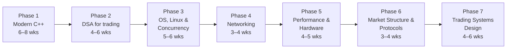

# Quant Developer roadmap

*Last reviewed: Oct 2026 · Total time: ~6–9 months at 10–15 hrs/week*

A Quant Developer builds the systems everything else runs on: market data handlers, backtesters, order management, and at HFT firms, trading engines where microseconds matter. Interviews lean heavily on **C++, data structures, operating systems and performance**, far more than on stochastic calculus.

Two flavours of the role, and this roadmap covers both:

- **Low-latency / HFT dev**: C++, Linux internals, networking, hardware awareness. Phases 1–6.
- **Research platform dev** (hedge funds, banks): Python + C++, data pipelines, backtesting infrastructure. Phases 1–3, then 6–7, lighter on 4–5.

Each phase lists **one primary resource** and **one backup**, then a **checkpoint** you must build before moving on.

---

## Phase 1 — Modern C++ 🟢→🟡 · 6–8 weeks

The non-negotiable foundation for HFT roles. Interviewers probe *why* the language works the way it does, not just syntax.

| | Resource | Verdict |
|---|---|---|
| **Primary** | [learncpp.com](https://www.learncpp.com/) 🆓 | The best free structured C++ course. Do it in order up to and including move semantics and smart pointers. |
| **Then** | Scott Meyers, *Effective Modern C++* 💸 | 42 items on C++11/14 idioms. Items on move semantics, `auto`, smart pointers and lambdas are classic interview material. |
| **Backup** | Bjarne Stroustrup, *A Tour of C++* (3rd ed.) 💸 | Short, authoritative overview if you already program in another language. |

**Must be solid on:** RAII, value vs. reference semantics, copy/move constructors and the rule of five, smart pointers and their costs, templates basics, `const` correctness, the STL containers and their complexity, undefined behaviour, virtual functions and the vtable cost.

**Skip for now:** template metaprogramming beyond the basics, C++20 modules and coroutines.

✅ **Checkpoint:** Implement your own `vector<T>` with correct copy/move semantics, growth strategy and iterators. Test it with a type that counts copies and moves.

---

## Phase 2 — Data structures & algorithms for trading 🟡 · 4–6 weeks

Standard interview DSA, plus the structures trading systems actually use.

| | Resource | Verdict |
|---|---|---|
| **Primary** | [NeetCode roadmap](https://neetcode.io/roadmap) + LeetCode 🆓 | Work the core patterns to medium level. Solve in C++ to build fluency. |
| **Backup** | Skiena, *The Algorithm Design Manual* 💸 | Better than CLRS for practical intuition; the "war stories" are memorable. |

**Must be solid on:** hash maps (and their worst cases), heaps, balanced trees vs. sorted arrays, ring buffers, intrusive linked lists, why cache-friendly flat structures often beat theoretically faster ones.

**Trading-specific:** how a limit order book is stored — price levels in a map or array, FIFO queues per level, O(1) cancel via a hash map from order ID to node.

✅ **Checkpoint:** [Project 10 — Limit order book](../projects/) core: add, cancel, and match orders with price-time priority, with unit tests.

---

## Phase 3 — Operating systems, Linux & concurrency 🟡→🔴 · 5–6 weeks

| | Resource | Verdict |
|---|---|---|
| **Primary** | Arpaci-Dusseau, [*Operating Systems: Three Easy Pieces*](https://pages.cs.wisc.edu/~remzi/OSTEP/) 🆓 | Clear, free, and covers exactly what interviews ask: processes, scheduling, virtual memory, concurrency. |
| **Primary (concurrency)** | Anthony Williams, *C++ Concurrency in Action* (2nd ed.) 💸 | The reference for `std::thread`, atomics and the memory model. Chapters 2–5 and 7 are essential. |
| **Reference** | Michael Kerrisk, *The Linux Programming Interface* 💸 | Don't read cover to cover; look up syscalls, signals, sockets and shared memory as needed. |

**Must be solid on:** processes vs. threads, context switches and their cost, virtual memory and page faults, mutexes vs. spinlocks, condition variables, `std::atomic` and memory ordering (acquire/release), false sharing, deadlock conditions.

**Skip for now:** kernel module development, filesystem internals.

✅ **Checkpoint:** A **lock-free single-producer single-consumer ring buffer** using `std::atomic` with acquire/release ordering. Benchmark it against a mutex-guarded `std::queue` and explain the difference.

---

## Phase 4 — Networking 🟡 · 3–4 weeks

| | Resource | Verdict |
|---|---|---|
| **Primary** | [*Beej's Guide to Network Programming*](https://beej.us/guide/bgnet/) 🆓 | Practical sockets programming in C. Short and enough to build real things. |
| **Backup** | Kurose & Ross, *Computer Networking: A Top-Down Approach* 💸 | For the theory behind TCP congestion control and routing. |

**Must be solid on:** TCP vs. UDP and why market data uses UDP multicast, Nagle's algorithm and `TCP_NODELAY`, blocking vs. non-blocking I/O, `epoll`, what kernel bypass means (and why firms use it).

✅ **Checkpoint:** A UDP multicast publisher and subscriber pair that sends sequenced messages and detects gaps (dropped packets) on the receiving side.

---

## Phase 5 — Performance & hardware awareness 🔴 · 4–5 weeks

This is what separates HFT developers from general software engineers.

| | Resource | Verdict |
|---|---|---|
| **Primary** | Bryant & O'Hallaron, *Computer Systems: A Programmer's Perspective*, ch. 5–6, 9 💸 | Optimising program performance, the memory hierarchy, and virtual memory — from the programmer's side. |
| **Primary (talks)** | Carl Cook, *When a Microsecond Is an Eternity* (CppCon 2017) 🆓 | The single best introduction to how HFT C++ is actually written. Watch twice. |
| **Talk** | David Gross, *Trading at Light Speed* (CppCon 2022) 🆓 | Low-latency design patterns from a practitioner. |
| **Reference** | Ulrich Drepper, *What Every Programmer Should Know About Memory* 🆓 | Dense; read the cache sections. |
| **Reference** | [Agner Fog's optimisation manuals](https://www.agner.org/optimize/) 🆓 | For when you need to know instruction latencies and microarchitecture details. |

**Must be solid on:** cache lines, locality and prefetching, branch prediction and why branchless code can win, heap allocation costs (and avoiding allocation on the hot path), inlining, measuring with `perf` and benchmarking with Google Benchmark without fooling yourself.

**Skip for now:** FPGA development — a specialist track, worth exploring only once you're inside a firm that uses it.

✅ **Checkpoint:** Profile your order book from Phase 2 with `perf`. Make it at least 2× faster through data layout changes (e.g. arrays instead of node-based maps, object pools) and document each change with before/after benchmarks.

---

## Phase 6 — Market structure & exchange protocols 🟡 · 3–4 weeks

You can't build a trading system without understanding what it's trading on.

| | Resource | Verdict |
|---|---|---|
| **Primary** | Larry Harris, *Trading and Exchanges* 💸 | The standard text on how markets work: order types, market makers, liquidity. Read parts I–III. |
| **Spec** | [Nasdaq TotalView-ITCH 5.0 specification](https://www.nasdaqtrader.com/content/technicalsupport/specifications/dataproducts/NQTVITCHSpecification.pdf) 🆓 | A real binary market-data protocol. Short and readable. |
| **Spec** | [FIX Trading Community](https://www.fixtrading.org/) 🆓 | The order-entry protocol most firms use. Learn message structure and the session layer. |
| **Backup** | NSE's published circulars on co-location and trading systems 🆓 | India-specific context on how the exchange operates. |

**Must be solid on:** order types (limit, market, IOC, FOK), price-time priority, maker/taker, tick sizes, auction phases, how a market data feed reconstructs the book from add/modify/delete messages.

✅ **Checkpoint:** An **ITCH 5.0 parser** that reads a sample file, reconstructs the order book for one symbol, and prints top-of-book at intervals. Measure messages per second.

---

## Phase 7 — Trading systems design 🔴 · 4–6 weeks

Bringing it together: how the components of a trading stack fit.

| | Resource | Verdict |
|---|---|---|
| **Primary** | Build it: an end-to-end event-driven backtester 🆓 | Nothing teaches system design faster than building one and hitting its limits. |
| **Backup** | Martin Kleppmann, *Designing Data-Intensive Applications* 💸 | For research-platform roles: storage, streaming and pipelines. Chapters 3, 5 and 11. |

**Must be solid on:** event-driven architecture, the path from market data → strategy → risk checks → order gateway, why backtest and live code should share logic, pre-trade risk controls, logging without slowing the hot path, deterministic replay for debugging.

✅ **Checkpoint:** [Project 03 — Honest backtester](../projects/03-honest-backtester/), then extend it into an event-driven design where the same strategy class can run against historical replay or a simulated live feed.

---

## Interview focus for QD roles

- **C++ deep dives:** "What happens when you call `push_back` on a full vector?", "Why might `virtual` be slow?", "Explain `std::move` — what does it actually do?"
- **Systems:** "What happens between a packet arriving at the NIC and your code seeing it?", "How would you avoid allocations in a hot loop?"
- **Design:** "Design an order book," "Design a market data handler that never drops messages."
- **Coding:** LeetCode-medium under time pressure, in C++.
- **Some probability:** less than QR/QT roles, but expect a few questions from the [probability set](../interview/probability.md).

## Portfolio checklist

By the end you should have, on GitHub, with READMEs and benchmarks:

- [ ] Custom `vector<T>` with tests
- [ ] Limit order book with price-time priority, profiled and optimised
- [ ] Lock-free SPSC queue with benchmarks
- [ ] ITCH parser reconstructing a real book
- [ ] Event-driven backtester
