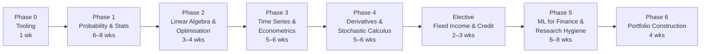

# Quant Researcher roadmap

*Last reviewed: Oct 2026 · Total time: ~7–9 months at 10–15 hrs/week*

A Quant Researcher's job is to find signals that are **real** (not artefacts of noise or bad data) and turn them into models that survive contact with the market. That's why this roadmap spends as much time on statistics and research hygiene as on finance.

Each phase lists **one primary resource** (do this) and **one backup** (only if the primary doesn't click). Then a **checkpoint project**. The phase isn't done until it's built. Cheat sheets for each phase are linked at the top of the phase.

## Time budget

| Phase | Weeks | Hours per week | Total hours (approx.) |
|---|---|---|---|
| 0 Tooling | 1 | 5 | 5 |
| 1 Probability & statistics | 6–8 | 12 | 70–95 |
| 2 Linear algebra & optimisation | 3–4 | 12 | 35–50 |
| 3 Time series & econometrics | 5–6 | 12 | 60–70 |
| 4 Derivatives & stochastic calculus | 5–6 | 12 | 60–70 |
| Elective: fixed income & credit | 2–3 | 10 | 20–30 |
| 5 ML for finance & research hygiene | 6–8 | 12 | 70–95 |
| 6 Portfolio construction | 4 | 12 | 45–50 |

Interview drills (20 minutes a day from Phase 2, see [interview prep](../interview/)) sit alongside the phases and are not counted above.

---

## Phase 0 — Tooling 🟢 · 1 week

Before the maths, set up the environment you'll use for every project.

- Python 3.11 or later, with `numpy`, `scipy`, `pandas`, `matplotlib`, `statsmodels`, `scikit-learn`.
- `git` and a GitHub repository with one folder per project. Commit as you go, not at the end.
- `pytest` for tests. Write a test for any function that could silently return a wrong number.
- Read [Pitfalls](../pitfalls.md) now. You'll want it in Phase 1.

✅ **Checkpoint:** a clean virtual environment, a repository with a README, and one passing test.

---

## Phase 1 — Probability & statistics 🟢→🟡 · 6–8 weeks

The single highest-return topic for every quant role and every interview.

| | Resource | Verdict |
|---|---|---|
| **Primary** | Blitzstein & Hwang, *Introduction to Probability*, with Harvard Stat 110 lectures 🆓 ([course](https://projects.iq.harvard.edu/stat110)) | Best intuition-first probability course available. Do the strategic practice problems. |
| **Backup** | Wasserman, *All of Statistics* 💸 | Terse but covers estimation and testing fast. |
| **Drill** | Zhou, *A Practical Guide to Quantitative Finance Interviews*, probability chapters 💸 | Interview-style problems; start these in week 3. Also see the [probability set](../interview/probability.md). |

**Cheat sheets:** [Distributions](../cheatsheets/distributions.md), [Performance metrics](../cheatsheets/performance-metrics.md) (for the estimation and testing sections).

**Must be solid on:** conditional probability and Bayes, expectation tricks (linearity, indicators, conditioning), common distributions and their moments, CLT, MLE, hypothesis testing, confidence intervals, regression basics and their assumptions.

**Skip for now:** measure theory, formal proofs of limit theorems.

✅ **Checkpoint:** [Project 01 — Monte Carlo option pricer](../projects/01-monte-carlo-pricer/). Check the standard error falls as 1/√N, and explain in one sentence why the drift is r.

---

## Phase 2 — Linear algebra & optimisation 🟡 · 3–4 weeks

| | Resource | Verdict |
|---|---|---|
| **Primary** | Gilbert Strang, MIT 18.06 🆓 ([OCW](https://ocw.mit.edu/courses/18-06-linear-algebra-spring-2010/)) | Watch for geometric intuition; skip determinant-heavy lectures. |
| **Backup** | Boyd & Vandenberghe, *Convex Optimization*, ch. 1–5 🆓 ([book](https://web.stanford.edu/~boyd/cvxbook/)) | Read only once you need constrained optimisation in Phase 6. |

**Must be solid on:** matrix decompositions (eigen, SVD, Cholesky), projections and least squares, PCA, covariance matrices, convexity, Lagrange multipliers.

**Skip for now:** abstract vector spaces, Jordan forms.

✅ **Checkpoint:** [Project 13 — PCA on NSE stocks](../projects/README.md). Interpret the first three components and test whether they correspond to market, sector and size. Report which interpretation fails.

---

## Phase 3 — Time series & econometrics 🟡 · 5–6 weeks

| | Resource | Verdict |
|---|---|---|
| **Primary** | Tsay, *Analysis of Financial Time Series* 💸 | Written for financial data specifically. Read the chapters on linear time series, and the volatility chapter, which is essential. |
| **Backup** | Hyndman & Athanasopoulos, *Forecasting: Principles and Practice* 🆓 ([book](https://otexts.com/fpp3/)) | Gentler, practical, R-based, but the concepts transfer. |

**Cheat sheets:** [Time series](../cheatsheets/time-series.md) (stationarity, ARMA, unit roots, GARCH, Kalman filter), [Performance metrics](../cheatsheets/performance-metrics.md) (for IC and forecast evaluation).

**Must be solid on:** stationarity and unit-root tests, ACF and PACF, AR, MA and ARMA, cointegration and error-correction models, GARCH family, heteroskedasticity-robust errors, why returns are not prices, why spurious regression happens.

**Skip for now:** Bayesian VARs, state-space models beyond the Kalman filter used for a time-varying hedge ratio.

✅ **Checkpoints:** [Project 05 — Pairs trading with cointegration](../projects/README.md) and [Project 07 — GARCH volatility forecasting](../projects/README.md). Both should use walk-forward evaluation, not a single in-sample fit.

---

## Phase 4 — Derivatives & stochastic calculus 🟡→🔴 · 5–6 weeks

Use the textbook chapters by topic rather than by number, since chapter numbers change between editions.

| | Resource | Verdict |
|---|---|---|
| **Primary** | Hull, *Options, Futures, and Other Derivatives* 💸. Read the chapters on futures and forwards, options markets, properties of options, Black-Scholes, Greeks, and volatility smiles. | The industry reference. |
| **Primary (maths)** | Shreve, *Stochastic Calculus for Finance II* 💸. Read the chapters on Brownian motion, Itô's lemma, and risk-neutral pricing. | Rigorous treatment of the stochastic calculus that Hull uses without proof. Read after Hull. |
| **Backup** | MIT 18.S096, *Topics in Mathematics with Applications in Finance* 🆓 ([OCW](https://ocw.mit.edu/courses/18-s096-topics-in-mathematics-with-applications-in-finance-fall-2013/)) | Lecture-format bridge between Hull and Shreve. |

**Cheat sheets:** [Greeks](../cheatsheets/greeks.md), [Stochastic calculus](../cheatsheets/stochastic-calculus.md), [Distributions](../cheatsheets/distributions.md).

**Must be solid on:** no-arbitrage, binomial trees, Black-Scholes derivation and assumptions, Greeks and their units, Itô's lemma, risk-neutral measure, implied volatility and the smile.

**Skip for now (QR):** exotic path-dependent pricing, unless you're targeting a derivatives desk. Interest-rate models are covered in the elective below.

✅ **Checkpoint:** [Project 02 — Implied volatility surface from NSE option chains](../projects/02-implied-vol-surface/). Optional: [Project 14 — Finite-difference Black-Scholes solver](../projects/14-finite-difference-black-scholes/).

---

## Elective — Fixed income & credit 🟡 · 2–3 weeks

Take this if you're aiming at rates, credit, or model-validation roles. It also underpins the [risk and model validation roadmap](risk-model-validation.md).

| | Resource | Verdict |
|---|---|---|
| **Primary** | Tuckman & Serrat, *Fixed Income Securities* 💸 | Practitioner treatment of bond pricing, duration, convexity, and the term structure. |
| **Primary (credit)** | Lando, *Credit Risk Modeling* 💸 | Reduced-form and structural credit models, with the statistics behind them. |

**Cheat sheets:** [Fixed income](../cheatsheets/fixed-income.md), [Credit risk](../cheatsheets/credit-risk.md).

**Must be solid on:** yield, duration and DV01, bootstrapping a zero curve, Nelson–Siegel fitting, PD, LGD and EAD, the Merton model and its limits.

✅ **Checkpoint:** Bootstrap a zero curve from a set of par bond prices, price a bond portfolio, compute its DV01, and hedge it with one other bond. Show the residual curve risk the single-instrument hedge leaves.

---

## Phase 5 — ML for finance & research hygiene 🔴 · 6–8 weeks

This is where most self-taught quants fail: their models work beautifully in backtests and nowhere else.

| | Resource | Verdict |
|---|---|---|
| **Primary** | James et al., *An Introduction to Statistical Learning* 🆓 ([book](https://www.statlearning.com/)) | Do this first if you haven't. Regularisation and cross-validation are prerequisites. |
| **Primary** | López de Prado, *Advances in Financial Machine Learning* 💸. Read the chapters on labelling, sample weights, cross-validation, and backtest overfitting. | Opinionated but essential. |
| **Required reading** | [Pitfalls](../pitfalls.md) | Read before writing a single backtest. |

**Cheat sheet:** [Performance metrics](../cheatsheets/performance-metrics.md), especially the sections on the probabilistic and deflated Sharpe ratio.

**Must be solid on:** bias-variance, regularisation, tree ensembles, why standard k-fold cross-validation leaks in time series, purging and embargo, multiple-testing corrections, the deflated Sharpe ratio.

**Skip for now:** deep learning for price prediction. Low signal-to-noise data punishes high-capacity models. Master the basics first.

✅ **Checkpoints:** [Project 03 — Honest backtester](../projects/03-honest-backtester/), then [Project 09 — Purged cross-validation for a ML signal](../projects/README.md). Optional: [Project 15 — Technical-indicator study](../projects/15-technical-indicator-study/), which applies the same discipline to classic rules.

---

## Phase 6 — Portfolio construction 🔴 · 4 weeks

| | Resource | Verdict |
|---|---|---|
| **Primary** | Grinold & Kahn, *Active Portfolio Management* 💸. Read the chapters on the fundamental law, forecasting, portfolio construction, and transaction costs. | The fundamental law of active management, and how signals become positions. |
| **Backup** | `PyPortfolioOpt` documentation and `cvxpy` examples 🆓 | Learn by implementing mean-variance, risk parity, and Black-Litterman. |

**Must be solid on:** mean-variance and its instability, covariance shrinkage, risk parity, transaction-cost-aware rebalancing, information ratio and IC.

✅ **Checkpoint:** Combine your Phase 5 signals into a cost-aware portfolio. Compare equal-weight and optimised portfolios out of sample, and report turnover and net-of-cost results.

---

## Portfolio checklist

By the end you should have, on GitHub, with READMEs, tests and clear results:

- [ ] Monte Carlo pricer with variance-reduction comparison ([Project 01](../projects/01-monte-carlo-pricer/))
- [ ] Implied volatility surface from real NSE data ([Project 02](../projects/02-implied-vol-surface/))
- [ ] Honest backtester with tests for look-ahead and costs ([Project 03](../projects/03-honest-backtester/))
- [ ] One stationary-spread or volatility project with walk-forward results
- [ ] One ML signal evaluated with purged cross-validation ([Project 09](../projects/README.md))
- [ ] A write-up of your best two projects, including what failed

---

## After the roadmap

- Start the [interview problem sets](../interview/) daily from Phase 2 onward.
- Enter a competition (WorldQuant BRAIN, Kaggle finance challenges). See [careers](../careers/india_opportunities.md).
- Write up your best two projects properly: hypothesis, data, method, results **including what failed**.
- Other paths: [Quant Developer](quant-developer.md), [Quant Trader](quant-trader.md), [Risk and Model Validation](risk-model-validation.md). See the [roadmap index](README.md) to compare them.
