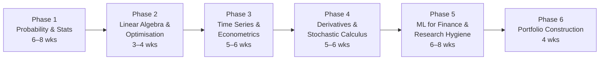

# Quant Researcher roadmap

*Last reviewed: Oct 2026 · Total time: ~6–9 months at 10–15 hrs/week*

A Quant Researcher's job is to find signals that are **real** (not artefacts of noise or bad data) and turn them into models that survive contact with the market. That's why this roadmap spends as much time on statistics and research hygiene as on finance.

Each phase lists **one primary resource** (do this) and **one backup** (only if the primary doesn't click). Then a **checkpoint project** — the phase isn't done until it's built.

---

## Phase 1 — Probability & statistics 🟢→🟡 · 6–8 weeks

The single highest-return topic for every quant role and every interview.

| | Resource | Verdict |
|---|---|---|
| **Primary** | Blitzstein & Hwang, *Introduction to Probability* + Harvard Stat 110 lectures 🆓 ([course](https://projects.iq.harvard.edu/stat110)) | Best intuition-first probability course available. Do the strategic practice problems. |
| **Backup** | Wasserman, *All of Statistics* 💸 | Terse but covers estimation and testing fast. |
| **Drill** | Zhou, *A Practical Guide to Quantitative Finance Interviews*, ch. 4 💸 | Interview-style problems; start these in week 3. |

**Must be solid on:** conditional probability & Bayes, expectation tricks (linearity, indicators, conditioning), common distributions, CLT, MLE, hypothesis testing, confidence intervals, regression basics.

**Skip for now:** measure theory, formal proofs of limit theorems.

✅ **Checkpoint:** [Project 01 — Monte Carlo option pricer](../projects/01-monte-carlo-pricer/)

---

## Phase 2 — Linear algebra & optimisation 🟡 · 3–4 weeks

| | Resource | Verdict |
|---|---|---|
| **Primary** | Gilbert Strang, MIT 18.06 🆓 ([OCW](https://ocw.mit.edu/courses/18-06-linear-algebra-spring-2010/)) | Watch for geometric intuition; skip determinant-heavy lectures. |
| **Backup** | Boyd & Vandenberghe, *Convex Optimization* ch. 1–5 🆓 ([book](https://web.stanford.edu/~boyd/cvxbook/)) | Read only once you need constrained optimisation in Phase 6. |

**Must be solid on:** matrix decompositions (eigen, SVD, Cholesky), projections and least squares, PCA, covariance matrices, convexity, Lagrange multipliers.

**Skip for now:** abstract vector spaces, Jordan forms.

✅ **Checkpoint:** [Project 13 — PCA on NSE stocks](../projects/): interpret the first three components (market, sector, size?).

---

## Phase 3 — Time series & econometrics 🟡 · 5–6 weeks

| | Resource | Verdict |
|---|---|---|
| **Primary** | Tsay, *Analysis of Financial Time Series*, ch. 1–3, 8 💸 | Written for financial data specifically; ch. 3 on volatility is essential. |
| **Backup** | Hyndman & Athanasopoulos, *Forecasting: Principles and Practice* 🆓 ([book](https://otexts.com/fpp3/)) | Gentler, practical, R-based but concepts transfer. |

**Must be solid on:** stationarity & unit-root tests, ACF/PACF, AR/MA/ARMA, cointegration, GARCH family, heteroskedasticity-robust errors, why returns ≠ prices.

**Skip for now:** state-space models, Bayesian VARs.

✅ **Checkpoint:** [Project 05 — Pairs trading with cointegration](../projects/) and [Project 07 — GARCH volatility forecasting](../projects/)

---

## Phase 4 — Derivatives & stochastic calculus 🟡→🔴 · 5–6 weeks

| | Resource | Verdict |
|---|---|---|
| **Primary** | Hull, *Options, Futures, and Other Derivatives*, ch. 10–15, 19–20 💸 | The industry reference. These chapters cover pricing, Greeks and volatility smiles. |
| **Primary (maths)** | Shreve, *Stochastic Calculus for Finance II*, ch. 3–5 💸 | Rigorous Brownian motion, Itô, risk-neutral pricing. Read after Hull. |
| **Backup** | MIT 18.S096, *Topics in Mathematics with Applications in Finance* 🆓 ([OCW](https://ocw.mit.edu/courses/18-s096-topics-in-mathematics-with-applications-in-finance-fall-2013/)) | Lecture-format bridge between Hull and Shreve. |

**Must be solid on:** no-arbitrage, binomial trees, Black-Scholes derivation and assumptions, Greeks, Itô's lemma, risk-neutral measure, implied volatility and the smile.

**Skip for now (QR):** interest-rate models, exotic path-dependent pricing — unless you're targeting a derivatives desk.

✅ **Checkpoint:** [Project 02 — Implied volatility surface from NSE option chains](../projects/02-implied-vol-surface/)

---

## Phase 5 — ML for finance & research hygiene 🔴 · 6–8 weeks

This is where most self-taught quants fail: their models work beautifully in backtests and nowhere else.

| | Resource | Verdict |
|---|---|---|
| **Primary** | James et al., *An Introduction to Statistical Learning* 🆓 ([book](https://www.statlearning.com/)) | Do this first if you haven't — regularisation and cross-validation are prerequisites. |
| **Primary** | López de Prado, *Advances in Financial Machine Learning*, ch. 2–8, 11–14 💸 | Labelling, purged cross-validation, backtest overfitting. Opinionated but essential. |
| **Required reading** | [Pitfalls](../pitfalls.md) | Read before writing a single backtest. |

**Must be solid on:** bias-variance, regularisation, tree ensembles, why standard k-fold CV leaks in time series, purging/embargo, multiple-testing corrections, deflated Sharpe ratio.

**Skip for now:** deep learning for price prediction. Low signal-to-noise data punishes high-capacity models; master the basics first.

✅ **Checkpoint:** [Project 03 — Honest backtester](../projects/03-honest-backtester/) then [Project 08 — Factor model for Indian equities](../projects/)

---

## Phase 6 — Portfolio construction 🔴 · 4 weeks

| | Resource | Verdict |
|---|---|---|
| **Primary** | Grinold & Kahn, *Active Portfolio Management*, ch. 2–6, 14 💸 | The fundamental law of active management; how signals become positions. |
| **Backup** | `PyPortfolioOpt` docs + `cvxpy` examples 🆓 | Learn by implementing mean-variance, risk parity, Black-Litterman. |

**Must be solid on:** mean-variance and its instability, covariance shrinkage, risk parity, transaction-cost-aware rebalancing, information ratio and IC.

✅ **Checkpoint:** Combine your Phase 5 signals into a cost-aware portfolio; compare equal-weight vs. optimised out-of-sample.

---

## After the roadmap

- Start the [interview problem sets](../interview/) daily from Phase 2 onward.
- Enter a competition (WorldQuant BRAIN, Kaggle finance challenges) — see [careers](../careers/india.md).
- Write up your best two projects properly: hypothesis, data, method, results **including what failed**.
