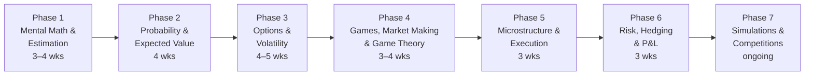

# Quant Trader roadmap

*Last reviewed: Oct 2026 · Total time: ~6–8 months at 10–15 hrs/week*

A Quant Trader prices, quotes and manages risk in real time. The job rewards fast, accurate estimation under pressure, a working intuition for options and volatility, and the discipline to take a small, repeated edge. Interviews are heavy on mental math, probability, expected value, and games with betting or market-making rules.

This roadmap is ordered by what you need first. Mental math is the entry filter at many firms, so it starts early and runs alongside the rest.

Each phase lists **one primary resource** and **one backup**, then a **checkpoint**. Interview drills run daily from Phase 2 onwards; see [interview prep](../interview/).

## Time budget

| Phase | Weeks | Hours per week | Total hours (approx.) |
|---|---|---|---|
| 1 Mental math & estimation | 3–4 | 10 | 30–40 |
| 2 Probability & expected value | 4 | 12 | 45–50 |
| 3 Options & volatility | 4–5 | 12 | 50–60 |
| 4 Games, market making & game theory | 3–4 | 12 | 35–50 |
| 5 Microstructure & execution | 3 | 12 | 35–40 |
| 6 Risk, hedging & P&L | 3 | 12 | 35–40 |
| 7 Simulations & competitions | ongoing | 2–3 | — |

---

## Phase 1 — Mental math & estimation 🟢 · 3–4 weeks

Many firms screen with a timed numerical test before anything else. Speed and accuracy under pressure are the skill.

| | Resource | Verdict |
|---|---|---|
| **Primary** | Daily timed arithmetic drills (see the [interview prep](../interview/README.md) table for the target scores) | Practise for 15–20 minutes a day. Track scores by week, not by session. |
| **Backup** | Arthur Benjamin and Michael Shermer, *Secrets of Mental Math* 💸 | Short, practical methods for multiplication, squares, and fast checks. |

**Must be solid on:** multiplication and division of two-digit numbers in your head, percentages and fractions as decimals, squares and square roots to a useful precision, compound growth and discounting by approximation, and sanity-checking any answer to within an order of magnitude.

**Skip for now:** memorised tricks for numbers beyond what you'll see in a screen. Focus on accuracy first.

✅ **Checkpoint:** hit the target score from the [interview prep](../interview/README.md) on three separate days in a row, and show that your error rate stays low when the time limit is tightened.

---

## Phase 2 — Probability & expected value 🟡 · 4 weeks

The core of trading interviews. You'll be asked to price a game, size a bet, or decide whether to take one.

| | Resource | Verdict |
|---|---|---|
| **Primary** | Zhou, *A Practical Guide to Quantitative Finance Interviews* 💸, probability chapters | Interview-style problems with worked solutions. Work every problem; don't just read them. |
| **Backup** | Mosteller, *Fifty Challenging Problems in Probability* 💸 | Short, elegant classics. Many interview questions derive from these. |

**Cheat sheet:** [Distributions](../cheatsheets/distributions.md) for the moments and common models. Use the [probability set](../interview/probability.md) for drills.

**Must be solid on:** expected value and linearity, conditional expectation, Bayes' rule with base rates, the Kelly criterion and why it maximises log growth, variance and risk of ruin, and simple random walks and first-passage problems.

**Skip for now:** measure-theoretic probability and formal proofs.

✅ **Checkpoint:** solve 30 problems from the probability set without hints, and for five of them explain the answer out loud in under three minutes each, as you would in an interview.

---

## Phase 3 — Options & volatility 🟡→🔴 · 4–5 weeks

A quant trader's book is mostly options and volatility. You need an intuitive grip on Greeks, implied and realised volatility, and what a trader is actually paid for.

| | Resource | Verdict |
|---|---|---|
| **Primary** | Sheldon Natenberg, *Option Volatility and Pricing* 💸 | The practitioner's book on options. Covers Greeks, spreads, and volatility trading in the way floor traders think about it. |
| **Primary** | Euan Sinclair, *Volatility Trading* 💸 | Volatility as an asset, including the variance risk premium and the realised-versus-implied comparison. |
| **Backup** | Hull, *Options, Futures, and Other Derivatives* 💸 (see the [Quant Researcher roadmap](quant-researcher.md), Phase 4) | Reference for the maths when the intuition needs checking. |

**Cheat sheets:** [Greeks](../cheatsheets/greeks.md) for formulas, units and the delta-hedging P&L relation.

**Must be solid on:** what each Greek means in money per day or per vol point, the P&L of a delta-hedged option (gamma against theta), how a straddle, strangle and butterfly behave, put-call parity, skew and term structure, and the difference between implied and realised volatility.

**Skip for now:** exotic options and the pricing of path-dependent products.

✅ **Checkpoints:** [Project 02 — Implied volatility surface](../projects/02-implied-vol-surface/) (reading the smile), and [Project 14 — Finite-difference Black-Scholes solver](../projects/14-finite-difference-black-scholes/) (checking the Greeks numerically).

---

## Phase 4 — Games, market making & game theory 🟡 · 3–4 weeks

Prop firms test how you set fair value under uncertainty, adjust to information, and size positions. Two good sources for the reasoning are a market-making model and a book on strategic thinking.

| | Resource | Verdict |
|---|---|---|
| **Primary** | Avellaneda and Stoikov (2008), "High-frequency trading in a limit order book," *Quantitative Finance* | The standard model of inventory-aware quoting. Read the derivation of the reservation price and the optimal spread. |
| **Primary** | Dixit and Nalebuff, *Thinking Strategically* 💸 | Game-theoretic reasoning in plain language: dominance, mixed strategies, and how to reason about other players. |
| **Backup** | Your own two-sided market games with friends (for example, quoting bid and ask on the sum of three dice) | Practice with real payoffs. Keep a log of your estimates and your errors. |

**Must be solid on:** fair value and edge, inventory risk and how it shifts quotes, bid-ask spread as compensation for adverse selection, dominance and equilibrium in simple games, and betting games with a known house edge.

**Skip for now:** full equilibrium analysis of large games.

✅ **Checkpoint:** [Project 11 — Market-making simulation](../projects/README.md). Implement quotes with an inventory penalty, and show how spread and inventory change as risk aversion changes.

---

## Phase 5 — Market microstructure & execution 🟡 · 3 weeks

Traders execute, and execution quality is measured against the market's microstructure. The [Quant Developer roadmap](quant-developer.md) covers the protocols in depth. This phase covers the trading side.

| | Resource | Verdict |
|---|---|---|
| **Primary** | Larry Harris, *Trading and Exchanges* 💸, parts I–III | Order types, market makers, liquidity and what they mean for a trader. |
| **Primary** | Joel Hasbrouck, *Empirical Market Microstructure* 💸 | The empirical side: spreads, price impact, and how to measure them. |
| **Reference** | NSE's published circulars on trading and market-making rules 🆓 | India-specific rules that change how you trade. |

**Must be solid on:** bid-ask spread decomposition, adverse selection, market impact and its square-root form, the cost of crossing the spread, VWAP and implementation shortfall as benchmarks.

✅ **Checkpoint:** [Project 10 — Limit order book simulator](../projects/README.md). Measure the realised spread and the effect of a large market order on the book.

---

## Phase 6 — Risk, hedging & P&L 🟡 · 3 weeks

A trader's P&L is only useful if you can decompose it and say which bets produced it.

| | Resource | Verdict |
|---|---|---|
| **Primary** | Nassim Nicholas Taleb, *Dynamic Hedging* 💸 | Hedging an options book in practice: gamma, vega, and the cost of rebalancing. |
| **Backup** | [Risk and Model Validation roadmap](risk-model-validation.md), Phase 3 | VaR, expected shortfall, and limits. |

**Must be solid on:** P&L attribution into delta, gamma, vega, theta and residual terms, delta-hedging frequency and its cost, position limits and stop-losses, and how VaR and expected shortfall are used to set limits.

✅ **Checkpoint:** [Project 12 — Risk engine: VaR and Expected Shortfall](../projects/README.md). Add a daily P&L attribution report for a small options book, using the Greeks from [Project 01](../projects/01-monte-carlo-pricer/).

---

## Phase 7 — Simulations & competitions 🟡 · ongoing

Practice against a live market, under real rules, is the closest thing to the job.

| | Resource | Verdict |
|---|---|---|
| **Competition** | [Ready Trader Go](https://readytradergo.optiver.com/) 🆓 | Optiver's student algorithmic trading competition. The 2023 edition has concluded; check the site for the next one. |
| **Competition** | [WorldQuant BRAIN](https://platform.worldquantbrain.com/) 🆓 | Alpha research with built-in data. Good for signal work, less so for execution. |
| **Practice** | Paper-trade a strategy from [Project 03](../projects/03-honest-backtester/) with real money off, for at least one month | Shows whether your backtest matches what happens live. |

✅ **Checkpoint:** one competition or paper-trading record, with a written review of your decisions and errors.

---

## Portfolio checklist

By the end you should have, with READMEs and clear results:

- [ ] Timed mental-math record, showing accuracy at target speed
- [ ] Market-making simulation with inventory risk ([Project 11](../projects/README.md))
- [ ] Options analysis with volatility surface and Greeks ([Project 02](../projects/02-implied-vol-surface/))
- [ ] Daily P&L attribution report for an options book
- [ ] One competition or paper-trading record with a review

## Other paths

[Quant Researcher](quant-researcher.md), [Quant Developer](quant-developer.md), [Risk and Model Validation](risk-model-validation.md). See the [roadmap index](README.md) to compare them.
