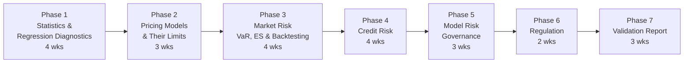

# Risk and Model Validation roadmap

*Last reviewed: Oct 2026 · Total time: ~6–8 months at 10–15 hrs/week*

Risk and model validation roles measure, stress and challenge the models that front-office teams build. The job is less about inventing a new model and more about asking whether a model is fit for its purpose, how it fails, and how much loss it can hide. Regulators, auditors and senior management rely on that judgement, so the skill is clear reasoning about uncertainty, plus enough technical depth to replicate a model and find its weaknesses.

This roadmap is a good fit if you come from statistics, econometrics or engineering and want a stable path into banks, insurers, asset managers and exchanges. It also leads into front-office quant work; see the adjacent-roles note in [careers](../careers/india_opportunities.md).

Each phase lists **one primary resource** and **one backup**, then a **checkpoint**. The checkpoints build a single validation report in Phase 7.

## Time budget

| Phase | Weeks | Hours per week | Total hours (approx.) |
|---|---|---|---|
| 1 Statistics & regression diagnostics | 4 | 12 | 45–50 |
| 2 Pricing models & their limits | 3 | 12 | 35–40 |
| 3 Market risk | 4 | 12 | 45–50 |
| 4 Credit risk | 4 | 12 | 45–50 |
| 5 Model risk governance | 3 | 12 | 35–40 |
| 6 Regulation | 2 | 10 | 20 |
| 7 Validation report | 3 | 12 | 35–40 |

---

## Phase 1 — Statistics & regression diagnostics 🟡 · 4 weeks

Validation starts with checking whether a model's assumptions hold and whether its estimates are stable.

| | Resource | Verdict |
|---|---|---|
| **Primary** | James et al., *An Introduction to Statistical Learning* 🆓 ([book](https://www.statlearning.com/)), chapters on linear regression and resampling | The vocabulary of model assessment, cross-validation and bootstrap, from the same book the Quant Researcher roadmap uses. |
| **Backup** | Christoffersen, *Elements of Financial Risk Management* 💸 | Risk-specific statistics, including backtesting and volatility forecasting. |

**Cheat sheets:** [Distributions](../cheatsheets/distributions.md), [Performance metrics](../cheatsheets/performance-metrics.md).

**Must be solid on:** the assumptions of linear regression and how to test them, heteroskedasticity and autocorrelation in residuals, bootstrap confidence intervals, out-of-sample testing, and the difference between statistical and economic significance.

✅ **Checkpoint:** write a short validation note on a simple regression model. Check its assumptions, its out-of-sample error, and whether its coefficients are stable across sub-periods. List every failed check.

---

## Phase 2 — Pricing models & their limits 🟡 · 3 weeks

A validator must know what a pricing model assumes, when those assumptions break, and what the model's error does to a book.

| | Resource | Verdict |
|---|---|---|
| **Primary** | Hull, *Options, Futures, and Other Derivatives* 💸. Use the chapters on Black-Scholes and on volatility smiles. | The reference for the standard models. |
| **Backup** | Hull, *Risk Management and Financial Institutions* 💸 | Written for risk managers; covers model risk and the risk-measurement side. |

**Cheat sheets:** [Greeks](../cheatsheets/greeks.md), [Stochastic calculus](../cheatsheets/stochastic-calculus.md).

**Must be solid on:** the Black-Scholes assumptions (constant volatility, lognormal prices, continuous hedging, no transaction costs) and which ones matter most for each product. Smiles, jumps and stochastic volatility. How to benchmark a model against an independent calculation.

✅ **Checkpoints:** [Project 01 — Monte Carlo pricer](../projects/01-monte-carlo-pricer/) and [Project 14 — Finite-difference Black-Scholes solver](../projects/14-finite-difference-black-scholes/). Use both as independent benchmarks: the two methods should agree within their stated errors, and you should be able to say where they disagree.

---

## Phase 3 — Market risk: VaR, expected shortfall & backtesting 🟡→🔴 · 4 weeks

| | Resource | Verdict |
|---|---|---|
| **Primary** | McNeil, Frey and Embrechts, *Quantitative Risk Management* 💸. Use the chapters on risk measures and extreme value theory. | Rigorous treatment of VaR and expected shortfall, and of the tail behaviour that matters in stress. |
| **Primary** | Basel Committee on Banking Supervision, [*Minimum capital requirements for market risk*](https://www.bis.org/bcbs/publ/d457.htm) (January 2019) 🆓 | The current market-risk capital framework (FRTB). Read the sections on the internal models approach and the expected shortfall requirement. |
| **Backup** | Jorion, *Value at Risk* 💸 | Practical introduction to VaR and its estimation methods. |

**Cheat sheet:** [Performance metrics](../cheatsheets/performance-metrics.md), tail-risk section.

**Must be solid on:** historical, parametric and Monte Carlo VaR, the reasons expected shortfall replaced VaR in the market-risk framework, backtesting VaR with exception counts and the Kupiec test, stressed VaR, and why a model can pass a backtest and still underestimate tail losses.

✅ **Checkpoint:** [Project 12 — Risk engine: VaR and Expected Shortfall](../projects/README.md). Backtest the VaR estimates with the Kupiec test and report which methods pass, and at which confidence levels they fail.

---

## Phase 4 — Credit risk 🔴 · 4 weeks

| | Resource | Verdict |
|---|---|---|
| **Primary** | Lando, *Credit Risk Modeling* 💸 | Reduced-form and structural models, with the statistics behind them. |
| **Backup** | Bluhm, Overbeck and Wagner, *Introduction to Credit Risk Modeling* 💸 | Portfolio credit risk and the factor models used for capital. |

**Cheat sheet:** [Credit risk](../cheatsheets/credit-risk.md), including the Merton model, hazard rates and the single-factor portfolio model.

**Must be solid on:** PD, LGD and EAD and how each is estimated, expected and unexpected loss, the Merton model's assumptions and failure modes, hazard rates and CDS spreads, default correlation and why it drives tail risk.

✅ **Checkpoint** (self-set, since no project covers this yet): build a Merton PD calculator for a set of firms, and a single-factor portfolio loss simulation. Check that the simulation's expected loss matches the analytical value, and show how the 99.9% loss quantile responds to correlation.

---

## Phase 5 — Model risk governance 🟡 · 3 weeks

Validation is a governance function. The output is a documented judgement that other people act on.

| | Resource | Verdict |
|---|---|---|
| **Primary** | Board of Governors of the Federal Reserve System, *SR 11-7: Guidance on Model Risk Management* (2011) 🆓 | The widely used US supervisory framework for model risk. Read it in full; it is short. Find the current copy on the Federal Reserve site. |
| **Backup** | Model risk management sections of banks' public annual reports and Pillar 3 disclosures 🆓 | Shows how the principles are applied in practice. Search the bank's investor pages for "model risk". |

**Must be solid on:** the three components of a validation (conceptual soundness, ongoing monitoring, outcomes analysis), challenger models, model inventory and tiering, documentation standards, and how limitations and overlays are reported.

✅ **Checkpoint:** write a one-page model risk tiering policy with three tiers, criteria for each tier, and the validation frequency and depth required at each.

---

## Phase 6 — Regulation 🟡 · 2 weeks

Read the rules that set the standard for the models you'll validate.

| | Resource | Verdict |
|---|---|---|
| **Primary** | [Basel market-risk framework](https://www.bis.org/bcbs/publ/d457.htm) (see Phase 3) | The international baseline. |
| **Primary (India)** | The Reserve Bank of India's current capital adequacy and market-risk directions, and SEBI's risk-management and margin framework for exchanges and clearing corporations 🆓 | Check the current versions on rbi.org.in and sebi.gov.in before relying on any requirement. Regulations change. |

**Must be solid on:** the difference between standardised and internal-model approaches, what capital requirements are for, and how Indian rules differ from the Basel baseline.

✅ **Checkpoint:** a one-page summary of how the market-risk capital requirement is calculated under the standardised approach, and which parts of your Phase 3 models would not be permitted under it.

---

## Phase 7 — Validation report 🔴 · 3 weeks

Bring the phases together in one document.

**Task:** choose a model you have built in this program (for example, the VaR engine from Project 12 or the Merton calculator from Phase 4), and write a validation report that covers:

1. **Purpose and scope.** What the model is for, who relies on it, and what decisions it informs.
2. **Conceptual soundness.** Assumptions, their justification, and where they break.
3. **Data.** Sources, adjustments, and known gaps. Link to the [data sources](../data/data-sources.md) checklist.
4. **Testing.** Benchmark against an independent calculation, backtesting, sensitivity to inputs, and stress scenarios.
5. **Findings.** Each finding rated by severity, with a recommended action.
6. **Limitations.** What the model cannot do, and how users should interpret its output.

✅ **Checkpoint:** a validation report of 5–8 pages, reviewed by someone who has not seen the model.

---

## Portfolio checklist

- [ ] Regression validation note with a list of failed checks (Phase 1)
- [ ] Independent benchmark of a pricing model ([Project 01](../projects/01-monte-carlo-pricer/), [Project 14](../projects/14-finite-difference-black-scholes/))
- [ ] VaR engine with Kupiec backtest ([Project 12](../projects/README.md))
- [ ] Merton calculator and single-factor portfolio simulation
- [ ] Model risk tiering policy
- [ ] Validation report

## Other paths

[Quant Researcher](quant-researcher.md), [Quant Developer](quant-developer.md), [Quant Trader](quant-trader.md). See the [roadmap index](README.md) to compare them.
